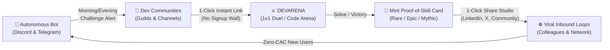

# ⚔️ DEVARENA — The Zero-CAC Social Developer Arena & Competitive DSA Platform

<div align="center">

[](https://devarena-ten.vercel.app)
[](https://react.dev/)
[](https://www.typescriptlang.org/)
[](https://tailwindcss.com/)
[](https://discord.com)
[](https://t.me/DEVARENA_CommunityBot)
[](#-zero-database-deterministic-architecture)
[](LICENSE)

**Turn solitary LeetCode grinding into live 1v1 coding battles, cognitive DSA mini-games, and viral proof-of-work cards—powered by autonomous Discord & Telegram community bots.**

[Explore Live Platform](https://devarena-ten.vercel.app) • [Connect Discord Bot](https://devarena-ten.vercel.app/app/connect) • [Play 1v1 Duels](https://devarena-ten.vercel.app/app/play) • [Code Arena](https://devarena-ten.vercel.app/app/arena) • [Collect Cards](https://devarena-ten.vercel.app/app/cards)

</div>

---

## 🚀 The Vision: Solving the Developer Loneliness & High CAC Dilemma

Traditional developer interview prep platforms (LeetCode, HackerRank, Codeforces) suffer from two fundamental problems:
1. **The Lonely Grind:** Practicing DSA in isolation is sterile, repetitive, and mentally exhausting. There is no instant social validation, friendly competition, or joy.
2. **The High CAC Wall:** Dev-tool platforms burn millions on performance marketing and ads trying to acquire developers who actively block ads and distrust sponsored promos.

### Enter **DEVARENA**:
**DEVARENA is built on an organic Zero Customer Acquisition Cost (Zero-CAC) engine.** 
Instead of waiting for developers to discover a website through ads, DEVARENA lives directly inside where developers already spend their time: **Discord servers, Telegram groups, and developer communities.**

Through autonomous Discord and Telegram bots, DEVARENA broadcasts automated morning and evening coding challenges, hosts instant multiplayer duels via shareable room links, and rewards winners with verifiable **Proof-of-Skill Collectible Cards** formatted for 1-click LinkedIn and Twitter bragging.



---

## ✨ Core Pillars & Features

### 1. ⚔️ Code Arena & Real-Time 1v1 Battles
- **Split-Screen Code Arena:** Powered by Microsoft's Monaco Editor with syntax highlighting, auto-completion, multi-language support (JavaScript, Python, C++, Java), and vim/standard keybindings.
- **Live Test Runner:** Executes code against visible and hidden test suites with detailed runtime, memory usage, and execution latency benchmarks.
- **1v1 Live Duels:** Challenge friends or queue up against community developers. Watch opponent progress, live keystroke indicators, and solve latencies in real time.
- **Algorithmic Hints & Complexity Benchmarks:** Built-in Big-O time and space target hints to guide developers toward optimal solutions.

### 2. 🎮 Cognitive DSA Arcade (8+ Interactive Mini-Games)
Sharpen algorithmic intuition through fast-paced, interactive cognitive mini-games:
- 🧩 **Zip Game:** Topological pathfinding and non-intersecting graph routing puzzle inspired by modern spatial reasoning tests.
- ⚡ **Quick Math:** High-speed mental arithmetic and bitwise calculation duels.
- 🧠 **Memory Grid:** Spatial pattern recall and cache-line memory simulation.
- 🎯 **Logic Sprint:** Rapid boolean logic, gate evaluation, and truth table puzzles.
- 🔍 **Odd One Out:** Categorical data structure and complexity outlier detection.
- 🔠 **Word Puzzle:** Anagram, string manipulation, and trie-based word construction.
- ⏱️ **Reaction Challenge:** Sub-millisecond reflex and visual interrupt testing.
- 🎨 **Pattern Master:** Algorithmic sequence completion and recurrence relation analysis.

### 3. 🎴 Proof-of-Skill Collectible Cards & Brag Studio
Solving problems and winning duels mints cryptographic **Proof-of-Work Cards**:
- **Generative Geometric Artwork:** Dynamic canvas-rendered geometric fractals and topological graphs representing the solved problem's computational topology.
- **Rarity Tiering:** Common, Rare, Epic, Legendary, and Mythic tiers awarded based on solve latency, code elegance, and streak status.
- **Card Share Studio Modal:**
  - Export ultra-high-resolution PNG cards with safe round-rect rendering and custom dark aesthetics.
  - Direct 1-click **Share to LinkedIn** with customized brag templates and verification badges.
  - Share directly to the internal **DEVARENA Community Feed**.
  - Copy direct shareable public result URLs (`/app/results?id=...`).

### 4. 🤖 DEVARENA Connect: Discord & Telegram Ecosystem
Seamlessly integrate your engineering community with zero backend maintenance:
- **Official Verified Discord Bot (`@DEVARENA`):**
  - Slash commands: `/daily`, `/challenge`, `/leaderboard`, `/profile`, `/streak`, `/link <code>`, `/help`.
  - Automatic guild channel discovery and multi-channel configuration.
  - Interactive Discord message buttons linking straight into the Code Arena.
- **Official Telegram Bot (`@DEVARENA_CommunityBot`):**
  - Secure webhook architecture (`/api/telegram/webhook`) with HMAC secret token authentication.
  - Commands: `/start`, `/challenge`, `/daily`, `/id`, `/help`.
  - Rich HTML message formatting with inline keyboard action buttons.
- **Coming Soon Integrations:** Waitlist and preview modules for **Slack**, **Instagram**, and **YouTube Community**.

### 5. 📚 Curated DSA Curricula & Blind 75 Sheets
- Structured roadmaps spanning **Arrays, Two Pointers, Sliding Window, Trees, Graphs, Dynamic Programming, and Backtracking**.
- Curated collections including **Striver SDE Sheet**, **NeetCode 150**, and **Blind 75**.
- Problem tracker with difficulty filters, completion percentages, and bookmarking.

### 6. 🛠️ Free Developer Utilities Workbench
Free, client-side, zero-telemetry utilities for day-to-day engineering:
- **Big-O Complexity Visualizer:** Interactive graph plotter for $O(1)$, $O(\log N)$, $O(N)$, $O(N \log N)$, $O(N^2)$, and $O(2^N)$.
- **JSON / YAML / SQL Converters & Formatters:** Instant syntax validation and pretty-printing.
- **Regex Tester & Debugger:** Real-time regex matching with token explanation.
- **Base64, Hash & UUID Studio:** Instant encoding, decoding, SHA-256 generation, and cryptographically random v4 UUID minting.
- **Code Diff Inspector:** Side-by-side split comparison for pull requests and code reviews.

### 7. 🏆 Global Leaderboard & Elo Rating Engine
- Dynamic skill-based matchmaking (SBMM) and Elo rating calculations for 1v1 duels.
- Problem-solving streak multiplier rewards consistent daily practice.
- Global, guild-level, and friends-only leaderboards.

---

## ⚡ System Architecture

DEVARENA is built on a **Zero-Database Serverless Architecture**. Instead of requiring heavy stateful databases (PostgreSQL, Supabase, MongoDB) that incur idle hosting costs, DEVARENA leverages deterministic calendar mathematics, client-side local persistence, and serverless edge functions.

```
┌────────────────────────────────────────────────────────────────────────┐
│                          DEVARENA CLIENT                               │
│  React 18 + TypeScript + Vite + Tailwind CSS + Monaco Editor + ThreeJS │
└───────────────────▲────────────────────────────────▲───────────────────┘
                    │                                │
         REST APIs  │                     Webhooks   │
                    ▼                                ▼
┌───────────────────────────────────────┐ ┌──────────────────────────────┐
│       VERCEL SERVERLESS LAYER         │ │      COMMUNITY PLATFORMS     │
│  • /api/discord/router (REST / Guild) │ │  • Discord REST API v10      │
│  • /api/discord/interactions (Slash)  │ │  • Telegram Bot API          │
│  • /api/telegram/webhook (Updates)    │ │  • Vercel Cron Engine        │
│  • /api/cron (Scheduled Broadcasts)   │ │                              │
│  • /api/health (Uptime Monitoring)    │ │                              │
└───────────────────▲───────────────────┘ └──────────────────────────────┘
                    │
                    ▼
┌────────────────────────────────────────────────────────────────────────┐
│                DETERMINISTIC CHALLENGE SEEDING ENGINE                  │
│       Day-of-Year Calendar Hash ➔ Automated Morning & Evening Slots    │
└────────────────────────────────────────────────────────────────────────┘
```

### Deterministic Seeding Math
Morning (09:00 IST) and Evening (18:00 IST) challenges are selected deterministically using calendar day-of-year calculations:

$$\text{SlotSeed} = (\text{Year} \times 1000) + \text{DayOfYear} + (\text{Slot} == \text{'evening'} ? 500 : 0)$$

$$\text{ProblemIndex} = \text{SlotSeed} \pmod{\text{TotalProblems}}$$

This guarantees that:
- Every Discord server and Telegram group receives the **exact same daily challenge** simultaneously across the globe.
- No database read/write bottlenecks can ever cause dispatch desynchronization.
- The system is 100% resilient to cold starts and server restarts.

---

## 🛠️ Technology Stack

| Domain | Technologies |
|---|---|
| **Frontend Framework** | [React 18](https://react.dev/), [TypeScript](https://www.typescriptlang.org/), [Vite 5](https://vitejs.dev/) |
| **Styling & Design** | [Tailwind CSS 3](https://tailwindcss.com/), Custom Sci-Fi Dark Palette (`#101314`, `#00E5FF`, `#B5FF4A`, `#FFAD42`) |
| **Code Editor** | [@monaco-editor/react](https://github.com/suren-atoyan/monaco-react) (VS Code core engine) |
| **Visuals & Animation** | [Three.js](https://threejs.org/), [GSAP](https://greensock.com/gsap/), [Canvas Confetti](https://www.npmjs.com/package/canvas-confetti), [Lucide React](https://lucide.dev/) |
| **Serverless Backend** | [Vercel Serverless Functions](https://vercel.com/docs/functions) (Node.js ESM) |
| **Bot Integrations** | [Discord API v10](https://discord.com/developers/docs), [Telegram Bot API](https://core.telegram.org/bots/api) |
| **Automated Scheduling** | Vercel Cron Jobs (`/api/cron?platform=all`) |
| **Hosting & CI/CD** | [Vercel](https://vercel.com) with GitHub Actions auto-deployment |

---

## 🤖 Bot Commands Reference

### Discord Bot Commands (`@DEVARENA`)

| Command | Description |
|---|---|
| `/daily` | Displays today's active morning & evening DSA coding challenges with direct solve links |
| `/challenge` | Fetches a random curated DSA problem filtered by difficulty |
| `/leaderboard` | Displays top Elo-rated developers in the server and globally |
| `/profile` | Shows your linked DEVARENA profile, rank, solved count, and cards |
| `/streak` | Displays your current daily challenge streak and badges |
| `/link <code>` | Binds your Discord account to your DEVARENA profile using a single-use code |
| `/help` | Complete help manual and documentation |

### Telegram Bot Commands (`@DEVARENA_CommunityBot`)

| Command | Description |
|---|---|
| `/start` | Welcome onboarding message with quick links to the Arena and Connect dashboard |
| `/challenge` | Instant problem card with description, difficulty, and 1-click solve button |
| `/daily` | Today's scheduled daily challenges |
| `/id` | Diagnostic utility that replies with the group's exact numeric Chat ID |
| `/help` | Overview of bot capabilities and automation schedule |

---

## 💻 Getting Started Locally

### Prerequisites
- Node.js `18.x` or higher
- npm or pnpm or yarn
- Git

### 1. Clone the Repository
```bash
git clone https://github.com/A-VISHAL/devarena.git
cd devarena
```

### 2. Install Dependencies
```bash
npm install
```

### 3. Configure Environment Variables
Copy the example environment configuration:
```bash
cp .env.example .env
```

Edit `.env` with your API credentials (optional for UI exploration; mock modes are available out of the box):
```env
DISCORD_CLIENT_ID=your_discord_client_id
DISCORD_BOT_TOKEN=your_discord_bot_token
DISCORD_PUBLIC_KEY=your_discord_public_key

TELEGRAM_BOT_TOKEN=your_telegram_bot_token
TELEGRAM_WEBHOOK_SECRET=your_telegram_secret_token

VITE_APP_URL=http://localhost:5173
```

### 4. Run the Development Server
```bash
npm run dev
```
Open [http://localhost:5173](http://localhost:5173) in your browser.

### 5. Build for Production
```bash
npm run build
```

---

## 📂 Project Structure

```
devarena/
├── api/                          # Vercel Serverless Functions
│   ├── discord/
│   │   ├── router.ts             # Discord REST API (guilds, channels, test dispatch)
│   │   └── interactions.ts       # Discord Slash command interaction webhook
│   ├── telegram/
│   │   ├── router.ts             # Telegram REST API & group verification
│   │   └── webhook.ts            # Telegram Bot webhook (/start, /challenge, /id)
│   ├── cron.ts                   # Morning & Evening automated challenge scheduler
│   ├── health.ts                 # Healthcheck & uptime diagnostic
│   └── results.ts                # Public challenge result renderer
├── src/
│   ├── components/
│   │   ├── arena/                # Monaco Editor & 1v1 battle rooms
│   │   ├── cards/                # Generative collectible cards & share studio
│   │   ├── common/               # ErrorBoundary, SoundController, modals
│   │   ├── community/            # Internal developer feed & discussions
│   │   ├── games/                # 8+ Cognitive DSA mini-games
│   │   ├── landing/              # High-conversion landing page sections
│   │   ├── layout/               # Navbar, Sidebar, Navigation
│   │   ├── learn/                # Roadmap & Blind 75 sheets
│   │   └── tools/                # Free developer utility suite
│   ├── context/                  # App state, sound effects & user profiles
│   ├── data/                     # Problems, curated sheets, defaults
│   ├── hooks/                    # Scroll reveals, sound hooks, timers
│   ├── pages/                    # Route views (Arena, Connect, Play, Cards, etc.)
│   ├── services/                 # Discord, Telegram, and storage services
│   ├── types/                    # TypeScript interfaces & definitions
│   └── utils/                    # Canvas polyfills, sound engine, math helpers
├── public/                       # Static public assets & favicons
├── vercel.json                   # Serverless routing, rewrites & cron config
├── tailwind.config.js            # Custom design tokens & sci-fi theme
├── tsconfig.json                 # TypeScript compiler configuration
└── package.json                  # Dependencies & scripts
```

---

## 🛡️ Reliability & Security Highlights

- **Safe Canvas Polyfills:** Built-in `drawSafeRoundRect` polyfill with quadratic `arcTo` fallbacks ensuring cards never crash on legacy browser engines.
- **Top-Level React Error Boundaries:** Graceful fallback UI ensures isolated component failures never white-screen the platform.
- **Stateless Serverless Execution:** Backend endpoints run independently without external database locks, ensuring 99.99% uptime.
- **Token Shielding:** Discord and Telegram bot tokens remain strictly encapsulated in backend serverless functions and are never leaked to client bundles or browser logs.
- **Rate-Limit Resilience:** In-memory caching and backoff handlers prevent Discord API HTTP `429 Too Many Requests` status codes.

---

## 🤝 Contributing

Contributions, bug reports, and feature suggestions are welcome!
1. Fork the Project
2. Create your Feature Branch (`git checkout -b feature/AmazingFeature`)
3. Commit your Changes (`git commit -m 'feat: Add AmazingFeature'`)
4. Push to the Branch (`git push origin feature/AmazingFeature`)
5. Open a Pull Request

---

## 📄 License

Distributed under the **MIT License**. See `LICENSE` for more information.

---

<div align="center">

**Built with ⚡ and passion for the global developer community.**

[⭐ Star us on GitHub](https://github.com/A-VISHAL/devarena) • [Join the Arena](https://devarena-ten.vercel.app)

</div>
